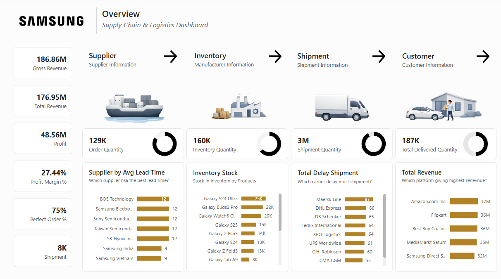

# 📦 Samsung Supply Chain & Logistics Dashboard

A comprehensive business intelligence dashboard designed to monitor end-to-end supply chain operations, gross and total revenue, inventory stock levels, fulfillment quantities, shipment lead times, and platform performance for Samsung.

---

## 📊 Project Overview
This project transforms complex supply chain and logistics metrics into actionable insights, helping stakeholders track gross revenue ($186.86M), total profit ($48.56M), supplier lead times, carrier shipment delays, and top-performing retail sales platforms.

---

## 🚀 Key Features & KPIs
- **Financial Performance:** Gross revenue tracking at **$186.86M**, total revenue at **$176.95M**, profit at **$48.56M**, and a profit margin of **27.44%**.
- **Logistics & Delivery:** **8K** total shipments tracked with a **75%** perfect order percentage.
- **Operational Flow Quantities:** 129K order quantities, 160K inventory quantities, 3M shipment quantities, and 187K total delivered quantities.
- **Interactive Slicers & Breakdowns:** Supplier lead times (e.g., BOE Technology, Samsung Electronics), product stock levels (Galaxy S24 Ultra, Galaxy Buds2 Pro), carrier delays (Maersk Line, DHL Express), and platform revenue channels (Amazon, Flipkart, Best Buy).

---

## 📈 Dashboard Preview

---

## 🛠️ Tools & Technologies
- **Tool:** Microsoft Power BI
- **Data Prep:** Power Query, DAX for calculated financial and supply chain measures.
- **UI Design:** Professional executive dark-mode layout optimized for supply chain tracking from supplier to customer.

---

## 💡 Key Insights
- **Top Revenue Platforms:** Amazon.com Inc. leads as the highest revenue-generating platform at **$37M**, closely followed by Flipkart, Best Buy, MediaMarkt Saturn, and Samsung Direct.
- **Lead Times & Delays:** Supplier lead times consistently average between 9 to 12 days across major partners like Samsung Vietnam and BOE Technology, while Maersk Line accounts for the highest carrier shipment delays.
- **Inventory Concentration:** Flagship hardware like the Galaxy S24 Ultra and Galaxy Buds2 Pro dominate total inventory stock counts.
